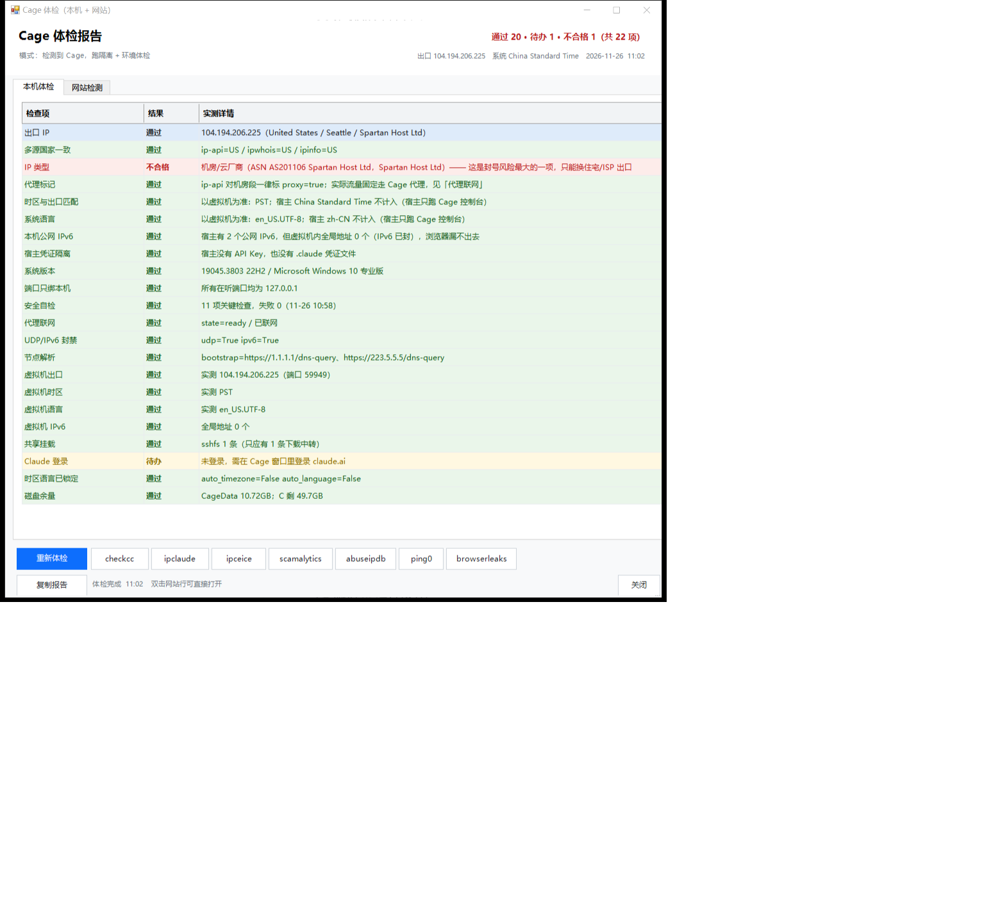
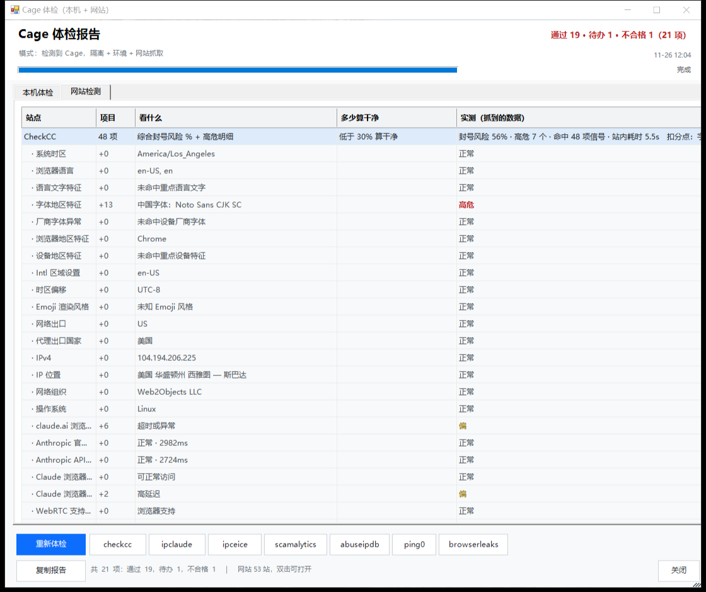

# cage-doctor — Claude Code 环境体检工具

一个给 **Claude-Cage**（虚拟机隔离版 Claude Code）做体检的只读小工具：一条命令把宿主机的硬件、Cage 的配置、客机的登录状态和出口 IP 全部过一遍，再顺手把 checkcc.org 那套「封号风险」信号抓下来，摊成一张表。

适用人群：在用 Claude Code 订阅号、又担心被风控的人。它帮你把「环境哪里不对」找出来，而不是替你保号。

## 它到底在查什么

分两块。

**第一块，本机体检。** Windows 版是 WinForms 窗口里 21 项，macOS 版是终端里 20 项左右，都是只读探测：

| 类别 | 查什么 | 为什么查 |
| --- | --- | --- |
| 系统底座 | 系统版本、CPU 架构、硬件虚拟化、内存、磁盘余量 | Cage 要在本机跑一个约 7GB 的虚拟机，底座不够会直接起不来 |
| Cage 自身 | 安装目录、cage 命令行、配置目录、客机镜像、控制器端口 17777/17778、代理端口 17896 | 端口不通就意味着「控制器不可用」，体检里的网络项会全部失败 |
| 客机状态 | SSH 端口、SSH 能否登录、Claude Code 版本、登录凭据是否存在、客机能否访问 claude.ai、客机时区 | 登录凭据没有就说明还没在 Cage 里登录过；claude.ai 不通则一切白搭 |
| 反特征 | 时区/语言是否被自动同步、共享目录、配置备份、安全自检报告 | 客机时区跟着宿主机走、语言跟着系统走，是最典型的地区特征 |

**第二块，网站检测。** 打开 checkcc.org，在 Cage 内置浏览器里真点一次「立即检测」，把页面算出来的分数和逐项扣分抓回来：

- CheckCC 总分（例如 56%）、高危项数量、信号项数量、耗时
- 48 项信号明细：项目名 / 实测值 / 扣了多少分，扣 13 分以上标「高危」，1~9 分标「偏」，0 分标「正常」
- 另外几个常被提到的站点入口（Scamalytics、ping0、browserleaks 等），双击行直接在浏览器打开

这些数据全部来自网站自己的判定，工具只负责抓取和排版，不改动任何一项检测结果。

## 它不是什么

说清楚边界，免得误会：

- **不改配置。** 全程只读。唯一的写操作是你在窗口里点「复制报告」，内容进剪贴板。
- **不上传数据。** 没有任何埋点、没有远程接口，报告只存在你本机。
- **不帮你绕过风控。** 它不伪造指纹、不切换 IP、不改时区，只告诉你现状离「干净环境」差多少。
- **不保证不封号。** 分数低只代表这次检测没撞到已知特征，平台侧的判定逻辑不公开，谁也无法承诺。

## 截图

Windows 版，本机体检页签：



Windows 版，网站检测页签：



## 快速开始

### Windows

前置：Windows 10 22H2 或更高，PowerShell 5.1 以上（系统自带就有），已装好 Claude-Cage。

1. 下载 Release 里的 `cage-doctor-windows.zip`，解压到任意目录（建议 D 盘，别放 C 盘）
2. 双击 `run-doctor.bat`
3. 窗口里先跑本机体检，几秒出结果；再切到「网站检测」页签，点「开始体检」

如果提示脚本被阻止运行，在 PowerShell 里执行一次：

```powershell
Set-ExecutionPolicy -Scope CurrentUser RemoteSigned
```

命令行单独跑（不弹窗、输出 JSON）：

```powershell
powershell -ExecutionPolicy Bypass -File cage-doctor.ps1 -Json
```

调试开关：`$env:CAGE_DOCTOR_TAB='web'` 启动即切到网站页签；`$env:CAGE_DOCTOR_DEBUG=1` 会把抓取原文写到 `%TEMP%\cc-out.txt`。

### macOS

前置：macOS 13 及以上，已装 Claude-Cage（`/Applications/Cage.app`）。

```bash
chmod +x cage-doctor-macos.sh
bash cage-doctor-macos.sh          # 彩色表格
bash cage-doctor-macos.sh --json   # 机器可读，方便接监控
```

退出码：全部通过或只有「注意/待办」返回 0，出现「不合格」返回 1，可以直接塞进 cron 或 CI 当门禁。

macOS 版是纯终端脚本，不依赖任何第三方库，也不需要 sudo。系统版本、虚拟化支持、内存磁盘、Cage 端口、客机 SSH 与登录凭据、claude.ai 可达性、时区，逐项打「通过 / 注意 / 不合格 / 待办」。

## 结果怎么读

四种状态：

- **通过** — 这一项符合预期，不用管
- **注意** — 能用，但有隐患（比如内存 8GB 勉强、Intel 芯片慢、代理端口没开）
- **不合格** — 硬性问题，不修就跑不通（虚拟化没开、客机连不上、claude.ai 返回 403）
- **待办** — 需要你手动完成，工具没法替你判断（登录 Claude、去浏览器点一次 checkcc、做配置备份）

### 「控制器不可用」是什么意思

代理联网、UDP/IPv6 封禁、节点解析这三项要走 Cage 桌面程序的本地控制服务（`127.0.0.1:17778`）。Cage 窗口没开、或者网络还没批准，控制服务就没起来，工具拿到的是 `service_unavailable`，于是显示「控制器不可用」。

处理办法：把 Cage 窗口打开，等它显示已联网、已就绪，再回来重新体检。工具本身会自动重试三次（每次 20 秒）。

## 常见问题

**分数很低但账号还是被封？** 分数只覆盖 checkcc 已知的检测面，浏览器指纹、请求行为、账号历史都在它的盲区里。

**网站检测卡在 0%？** 首页要点「立即检测」，弹层里再点「开始检测」，两步都要等页面完全加载。抓取依赖本机浏览器，页面改版会失效，这时用页面上的手动模式。

**检查项一直显示未监听？** 先确认 Cage 是不是真的在跑：任务管理器里应该能看到 cage.exe 和一个 qemu 进程。

**能不能在服务器上跑？** Windows 版需要桌面（WinForms），macOS 版是纯 shell，Linux 服务器可以跑 macOS 版——大部分项目会因为找不到 Cage 而标「不合格」，但主机底座那几项仍然有效。

## 目录结构

```
cage-doctor/
├── windows/
│   ├── cage-doctor.ps1      # 主程序，单文件 WinForms
│   └── run-doctor.bat       # 双击入口
├── macos/
│   └── cage-doctor-macos.sh # 终端体检脚本
└── screenshots/
    ├── windows-local.png
    └── windows-web.png
```

## 关于 Claude-Cage

本项目只是外围体检工具，Cage 本体在 [Lee-xeo/Claude-Cage](https://github.com/Lee-xeo/Claude-Cage)，官网文档 [claude-cage.com/docs](https://claude-cage.com/docs/)。下载安装包请只从官方文档站或 GitHub Releases 取，认准文件名 `Cage-x.y.z-windows-amd64-setup.exe`，不要用第三方「加速下载」。

注意别和另一个同名项目 `PACHAKUTlQ/ClaudeCage` 搞混：那是 bwrap 单文件沙箱，没有虚拟机隔离，登录仍要借用宿主浏览器。

## 许可

MIT，见 LICENSE。工具按现状提供，不附带任何担保；因使用本工具产生的账号风险由使用者自行承担。
